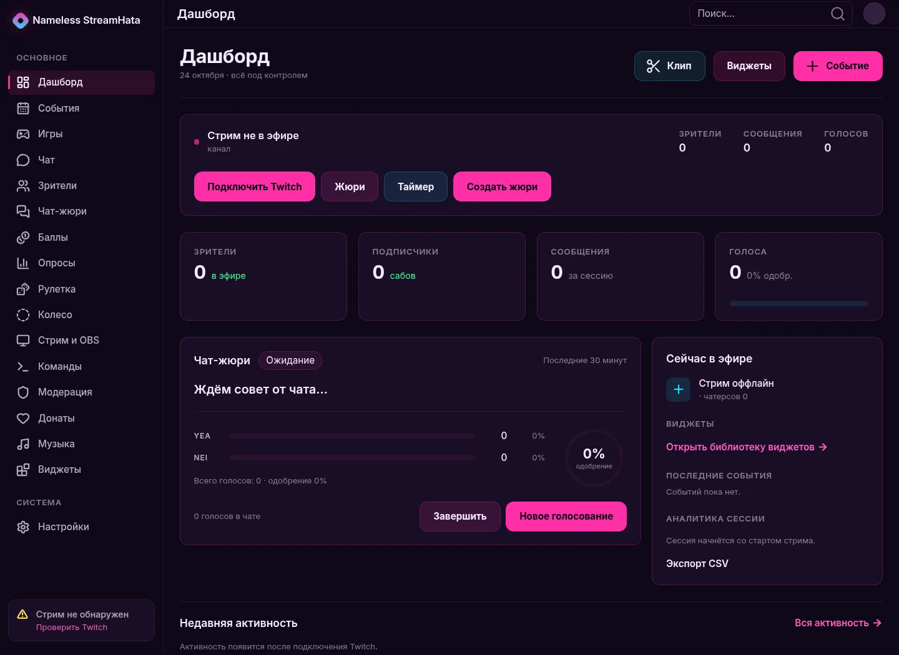
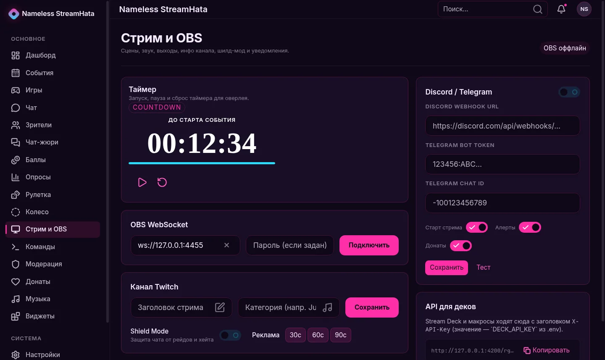
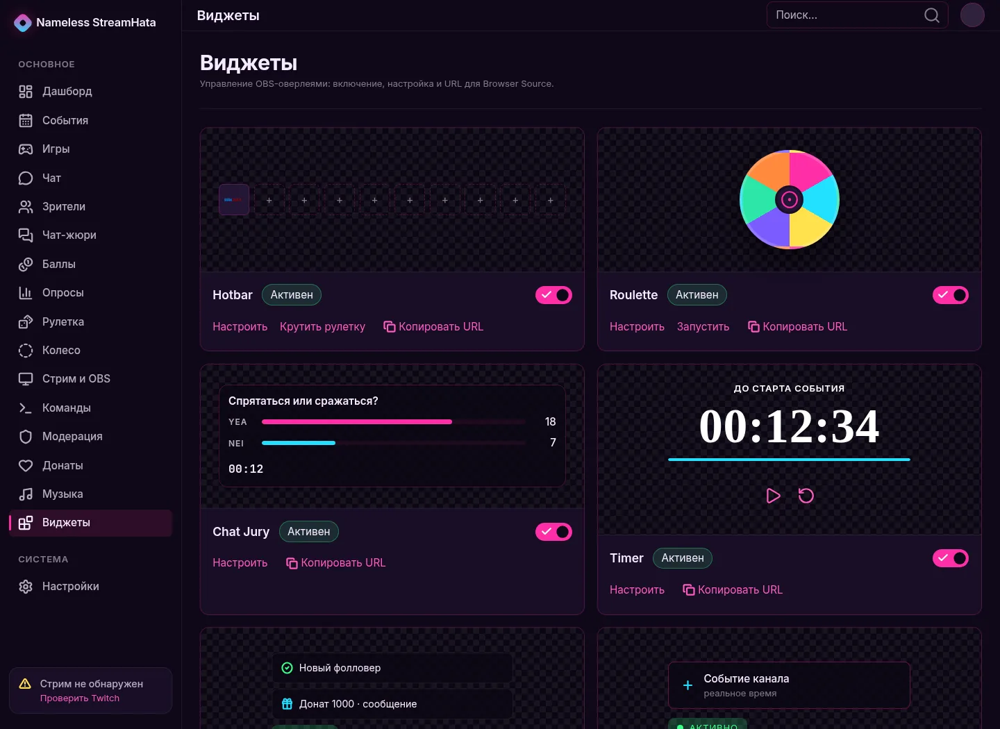
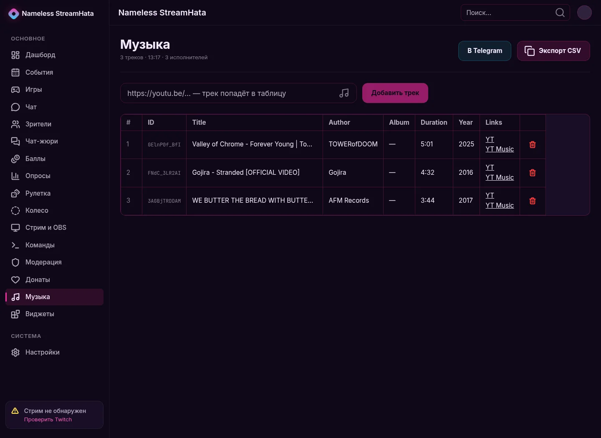
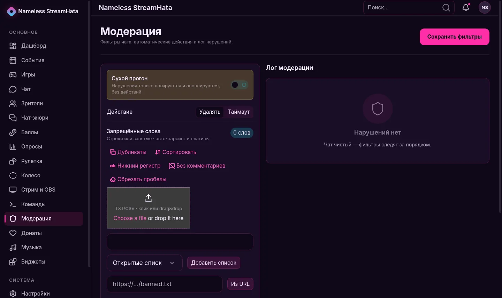
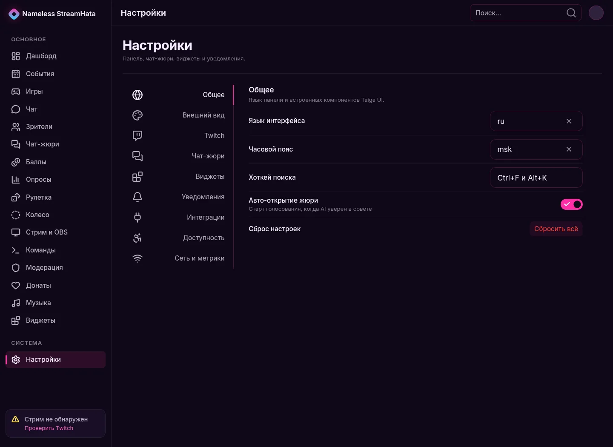

# Nameless StreamHata Desktop

**Русский** · [English](#english)

Desktop-клиент StreamHata для Twitch-стримеров на Tauri 2. Обёртывает панель StreamHata в системное окно и добавляет то, чего нет в браузере: трей, безопасное хранение сессии, системные уведомления, OTA-обновления, системный виджет и удобный запуск OBS-сценариев.

Текущая версия: **0.1.0-alpha**. Это ранняя сборка: Windows-установщик пока **без Authenticode-подписи**, поэтому SmartScreen может показать предупреждение.

Репозиторий: `https://github.com/Stream-Hata/streamhata-desktop`

---

## Русский

### Что это

StreamHata Desktop — не отдельный стриминговый клиент и не замена OBS. Это нативное приложение, которое открывает вашу панель StreamHata и связывает её с компьютером стримера:

- хранит сессию Twitch в системном keychain;
- работает в трее и не мешает эфиру;
- показывает системные уведомления о событиях;
- запускает обновления;
- отдаёт локальный виджет с CPU/GPU/RAM/сетью;
- помогает управлять OBS через WebSocket.

Приложение рассчитано на стримеров, которые уже используют StreamHata и хотят держать панель, OBS и уведомления под рукой.

### Возможности

- **Вход через Twitch** — авторизация в системном браузере, токен остаётся в OS keychain.
- **Панель управления** — dashboard, профиль, игры, события, зрители, чат, баллы, донаты, модерация.
- **Стрим и OBS** — подключение к OBS WebSocket, сцены, источники, звук, старт/стоп стрима и записи.
- **Виджеты и оверлеи** — Now Playing, чат, рулетка, колесо, таймер, опросы и другие виджеты.
- **Чат-жюри** — голосование зрителей и AI-анализ сообщений.
- **Музыка** — трек-лист, YouTube и прямые MP3/аудио-ссылки, экспорт.
- **Уведомления** — Twitch-события, донаты, алерты; настройка Telegram/Discord.
- **Системный виджет** — CPU, GPU, память и сеть в отдельном окне/оверлее.
- **Трей** — закрытие окна сворачивает приложение, а не завершает его.
- **Обновления** — OTA-обновления с подписанным манифестом.
- **Статус и обратная связь** — встроенные ссылки на статус-страницу и фидбек.

### Скриншоты

| Dashboard | Stream & OBS |
| --- | --- |
|  |  |

| Виджеты | Музыка |
| --- | --- |
|  |  |

| Модерация | Настройки |
| --- | --- |
|  |  |

Больше экранов: `web/help/` (games, roulette, wheel, polls, chat jury, viewers, notifications, donations, events, profile, commands, hotbar, login, landing).

### Установка

#### Windows

1. Скачайте `StreamHata_*_x64-setup.exe` из последнего релиза.
2. Запустите установщик. Если SmartScreen покажет предупреждение — это ожидаемо для alpha-сборки без подписи.
3. Запустите **Nameless StreamHata**.
4. Войдите через Twitch в открывшемся браузере.
5. Разрешите уведомления, если хотите получать события на рабочий стол.

#### Linux

1. Скачайте `.AppImage` или `.deb` из релиза.
2. AppImage: `chmod +x StreamHata_*.AppImage && ./StreamHata_*.AppImage`.
3. Debian/Ubuntu: `sudo apt install ./StreamHata_*.deb`.
4. Запустите приложение и войдите через Twitch.

### Первый запуск

1. Приложение открывает окно входа.
2. Нажмите **Войти через Twitch**.
3. Браузер откроет страницу авторизации StreamHata.
4. После входа приложение получит одноразовый код и сохранит сессию в keychain.
5. Откроется dashboard.

Если окно закрылось, приложение остаётся в трее. Клик по иконке возвращает окно, меню трея позволяет открыть настройки или выйти.

### OBS

1. Установите OBS Studio и включите **Tools → WebSocket Server Settings**.
2. В приложении откройте **Стрим и OBS**.
3. Укажите адрес `ws://127.0.0.1:4455` и пароль OBS WebSocket.
4. Подключитесь: появятся сцены, источники и выходы.
5. Для оверлеев используйте ссылки из раздела **Виджеты**.
6. Для встроенного браузера в OBS используйте плагин `obs-widget-browser` (Qt WebEngine, без CEF).

### Сборка из исходников

Требования:

- Rust stable;
- Node.js и pnpm;
- Tauri 2 prerequisites;
- Linux: WebKitGTK 4.1, GTK 3, libappindicator, librsvg;
- Windows: WebView2, MSVC Build Tools.

```bash
pnpm install
cargo build --release
```

Windows NSIS-установщик собирается в GitHub Actions:

```bash
# локально на Windows
npx -y @tauri-apps/cli@2 build --bundles nsis --no-sign
```

### Подпись и обновления

- **Updater** использует отдельный minisign-ключ Tauri. Публичный ключ находится в `src-tauri/tauri.conf.json`; приватный ключ хранится вне репозитория.
- **Windows Authenticode** пока не настроен: NSIS собирается с `--no-sign`.
- Не используйте самоподписанный сертификат как публичный — SmartScreen его не признаёт.
- Для CI нужны secrets:
  - `TAURI_SIGNING_PRIVATE_KEY`
  - `TAURI_SIGNING_PRIVATE_KEY_PASSWORD`

### Безопасность

- Токены Twitch не пишутся в localStorage и файлы приложения.
- Сессия хранится в OS keychain.
- Приватные ключи и токены не должны попадать в репозиторий.
- Для публичных сборок используйте только CI-артефакты и проверяйте SHA-256.

### CI

- `.github/workflows/build-linux.yml` — AppImage/DEB.
- `.github/workflows/build-windows.yml` — NSIS без Authenticode.
- `.github/workflows/ci.yml` — `cargo fmt`, `clippy -D warnings`, тесты, `cargo audit`, `cargo deny`.

### Частые проблемы

**SmartScreen предупреждает.** Это alpha-сборка без подписи. Скачивайте только из официального релиза и сверяйте SHA-256.

**Не открывается вход.** Проверьте, что браузер по умолчанию доступен и StreamHata backend отвечает.

**OBS не подключается.** Проверьте WebSocket URL, пароль и что OBS запущен.

**Нет уведомлений.** Разрешите уведомления в настройках ОС и включите нужные события в приложении.

### Ссылки

- Панель: `https://streamhata.rdpctd.dev`
- Статус: `https://status.streamhata.rdpctd.dev`
- Обратная связь: `https://streamhata.rdpctd.dev/feedback`
- Релизы: `https://github.com/Stream-Hata/streamhata-desktop/releases`

---

## English

### What it is

StreamHata Desktop is not a standalone streaming client and not an OBS replacement. It is a native shell around the StreamHata control panel that connects the panel to the streamer's computer:

- stores the Twitch session in the OS keychain;
- lives in the system tray;
- delivers native notifications;
- installs updates;
- exposes a local CPU/GPU/RAM/network widget;
- manages OBS through WebSocket.

It is built for Twitch streamers who already use StreamHata and want the panel, OBS controls and notifications in one place.

### Features

- **Twitch sign-in** — browser-based OAuth, token stored in the OS keychain.
- **Control panel** — dashboard, profile, games, events, viewers, chat, points, donations, moderation.
- **Stream & OBS** — OBS WebSocket, scenes, sources, audio, stream/record start and stop.
- **Widgets & overlays** — Now Playing, chat, roulette, wheel, timer, polls and more.
- **Chat jury** — viewer voting and AI-assisted message analysis.
- **Music** — playlist, YouTube and direct MP3/audio links, export.
- **Notifications** — Twitch events, donations, alerts; Telegram/Discord settings.
- **System widget** — CPU, GPU, memory and network in a separate window/overlay.
- **Tray** — closing the window minimizes to tray instead of quitting.
- **Updates** — signed OTA update manifests.
- **Status & feedback** — quick links to the status page and feedback form.

### Screenshots

| Dashboard | Stream & OBS |
| --- | --- |
|  |  |

| Widgets | Music |
| --- | --- |
|  |  |

| Moderation | Settings |
| --- | --- |
|  |  |

More screens are available in `web/help/`.

### Installation

#### Windows

1. Download `StreamHata_*_x64-setup.exe` from the latest release.
2. Run the installer. SmartScreen may warn you because this alpha build is unsigned.
3. Launch **Nameless StreamHata**.
4. Sign in with Twitch in the browser window.
5. Allow desktop notifications if you want native alerts.

#### Linux

1. Download the `.AppImage` or `.deb` from the release.
2. AppImage: `chmod +x StreamHata_*.AppImage && ./StreamHata_*.AppImage`.
3. Debian/Ubuntu: `sudo apt install ./StreamHata_*.deb`.
4. Launch the app and sign in with Twitch.

### First launch

1. The sign-in window opens.
2. Click **Sign in with Twitch**.
3. Complete OAuth in your browser.
4. The app exchanges the one-time code and stores the session in the OS keychain.
5. The dashboard opens.

Closing the window keeps the app in the tray. Use the tray icon to restore it or quit.

### OBS

1. Install OBS Studio and enable **Tools → WebSocket Server Settings**.
2. Open **Stream & OBS** in the app.
3. Enter `ws://127.0.0.1:4455` and the OBS WebSocket password.
4. Connect to load scenes, sources and outputs.
5. Copy overlay URLs from **Widgets**.
6. For an embedded OBS browser source, use the `obs-widget-browser` plugin (Qt WebEngine, no CEF).

### Build from source

Requirements:

- Rust stable;
- Node.js and pnpm;
- Tauri 2 prerequisites;
- Linux: WebKitGTK 4.1, GTK 3, libappindicator, librsvg;
- Windows: WebView2, MSVC Build Tools.

```bash
pnpm install
cargo build --release
```

Windows NSIS builds run in GitHub Actions:

```bash
# local Windows build
npx -y @tauri-apps/cli@2 build --bundles nsis --no-sign
```

### Signing and updates

- **Updater** uses a separate Tauri minisign key. The public key is in `src-tauri/tauri.conf.json`; the private key stays outside the repository.
- **Windows Authenticode** is not configured yet: NSIS is built with `--no-sign`.
- Do not use a self-signed certificate as a public release certificate — SmartScreen will not trust it.
- CI secrets:
  - `TAURI_SIGNING_PRIVATE_KEY`
  - `TAURI_SIGNING_PRIVATE_KEY_PASSWORD`

### Security

- Twitch tokens are not stored in localStorage or app files.
- The session lives in the OS keychain.
- Private keys and tokens must never be committed.
- For public releases, use CI artifacts only and verify SHA-256.

### CI

- `.github/workflows/build-linux.yml` — AppImage/DEB.
- `.github/workflows/build-windows.yml` — unsigned NSIS.
- `.github/workflows/ci.yml` — `cargo fmt`, `clippy -D warnings`, tests, `cargo audit`, `cargo deny`.

### Troubleshooting

**SmartScreen warning.** Expected for an unsigned alpha build. Download only from the official release and verify SHA-256.

**Sign-in does not open.** Make sure a default browser is available and the StreamHata backend is reachable.

**OBS does not connect.** Check the WebSocket URL, password and that OBS is running.

**No notifications.** Allow notifications in the OS settings and enable the relevant events in the app.

### Links

- Panel: `https://streamhata.rdpctd.dev`
- Status: `https://status.streamhata.rdpctd.dev`
- Feedback: `https://streamhata.rdpctd.dev/feedback`
- Releases: `https://github.com/Stream-Hata/streamhata-desktop/releases`
